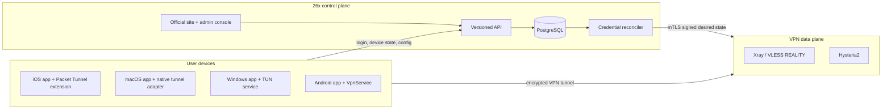

# 26x VPN — System Architecture

## Trust boundaries

## Components

### Clients

- Flutter owns shared UI, account flow, localization, and node presentation.
- A narrow Dart `TunnelController` talks to a platform adapter. It exposes state and sanitized diagnostics, not raw protocol secrets.
- `libXray` v26.11.9 is pinned for the first integration slice. The Xray core supports VLESS+REALITY, Hysteria2 and TUN input; iOS/macOS use Network Extension, Android uses `VpnService`, and Windows needs a signed TUN service. See [`adr/0002-vpn-engine-selection.md`](adr/0002-vpn-engine-selection.md) for platform lifecycle, license obligations, and release gates.
- iOS/macOS use native Network Extension integration. Android uses `VpnService`. Windows uses a signed service/TUN integration. Each platform owns its permission and lifecycle handling.

### Control plane

- Go API, PostgreSQL, and a small credential-reconciliation worker.
- The API is the source of truth for users, devices, plans, subscriptions, and node metadata.
- Nodes receive desired state from a control-plane agent. Private keys and protocol credentials are encrypted at rest and never returned to browser code.
- Public site and admin console use separate routes and authorization policies. Admin mutations require CSRF protection, role checks, and audit entries.

### Data plane

- The existing VPN server remains a development node: Hysteria2/UDP 443 and Xray VLESS+REALITY/TCP 8443. Its public address is kept out of this source tree.
- Production nodes are separate from the admin/API host. Node control is pulled over authenticated channels; the public VPN listener does not expose admin ports.
- Evaluate moving REALITY from TCP 8443 to TCP 443 during the network reachability phase. Hysteria2 is UDP 443, so the transport port number can coexist, subject to cloud security-group rules.

## DNS and ingress layout

One registered brand domain is enough. The owner has purchased `26xvpn.com`; both the apex and `www` records resolve to the Hong Kong host. The public site is deployed with HTTPS; see [`deploy-26xvpn-com.md`](deploy-26xvpn-com.md) for current status.

| Hostname | Maps to | Purpose |
|---|---|---|
| `26xvpn.com`, `www.26xvpn.com` | Current Hong Kong development host | Next.js site, customer account pages, and admin route at `/admin`. |
| `26xvpn.com/api/*` | Nginx forwards to the Go API on a loopback listener | Same-origin account/admin API; PostgreSQL stays private and is never a DNS target. |
| `hk-01.nodes.26xvpn.com` | A VPN data-plane host, when configured | VPN traffic only; add an explicit record per node when a client profile uses it. |

For the requested initial single-server phase, the owner has chosen to point the website domain at the existing VPN development host. Run the site and API behind an HTTPS reverse proxy there, while keeping the current API and database bound to local/private interfaces. Next.js recommends a reverse proxy when self-hosting. Hysteria2 uses UDP 443 and the website uses TCP 443; these are separate transports, but each needs its own firewall rule. This co-location is a development/private-beta arrangement, not the recommended public production boundary. Move the control plane away from the VPN node before a public beta. Keep HTTP CDN proxying off for VPN node records unless a provider explicitly supports that VPN transport.

The single-server deployment template is in `docs/deploy-26xvpn-com.md` and `deploy/nginx/26xvpn.com.conf.example`. The `api.26xvpn.com` subdomain is not required for the current same-origin API routing and does not currently resolve.

For VLESS+REALITY, the server address hostname and the TLS `serverName` are separate client settings. A REALITY `serverName` may be a deliberate decoy host; don't assume it should equal the website or node hostname. Configure both from the active node profile and test them independently.

### Initial beta footprint

For a public beta, plan for one control-plane host (API and PostgreSQL) and two VPN data-plane nodes in separate failure domains. Keep the website/admin in the same Next.js deployment; it can use a managed Next.js host, or run as a separate process behind the control-plane reverse proxy during a small beta. This is a minimum availability-oriented starting point, not a production scale estimate. The current single development node is enough for private integration work, not service failover.

## Data lifecycle

1. User authenticates over HTTPS.
2. Client registers or refreshes a device record.
3. API checks subscription and device limits.
4. API is intended to return protocol-neutral node metadata plus a short-lived, device-bound configuration envelope. The current bootstrap returns metadata only and explicitly marks every node not connectable.
5. Credential worker reconciles node credentials. Revocation is idempotent and auditable.
6. Client reports only app/core version, connection outcome, and optional byte counters.

## API outline

The current scaffold implements these routes:

- `POST /api/v1/auth/session`, `DELETE /api/v1/auth/session`, `GET /api/v1/me`, `POST /api/v1/me/password`
- `GET /api/v1/me/devices`, `POST /api/v1/me/devices`, `DELETE /api/v1/me/devices/{id}`
- `GET /api/v1/client/bootstrap?deviceId=...` (metadata only; nodes remain non-connectable)
- `POST /api/v1/admin/session`, `DELETE /api/v1/admin/session`, `GET /api/v1/admin/me`
- Admin overview, users, devices, plans, subscriptions, nodes, and audit routes are listed in `api/README.md`.

Public registration, email verification, password recovery, session refresh, heartbeat, usage ingestion, and per-device credential delivery are planned but not implemented. Admin writes require an authenticated role and CSRF token, and emit an audit event.

## Operational baseline

- HTTPS at the edge, HSTS, secure cookies, rate limits on authentication, and per-account/device throttles.
- PostgreSQL encrypted backups, migration history, and a tested restore procedure.
- Node health checks distinguish listener reachability, protocol handshake, and outbound internet reachability.
- Structured logs redact tokens, UUIDs, public/private keys, and user traffic metadata.
- Metrics cover node availability, handshake outcomes, API latency, credential reconciliation lag, and app release version.
